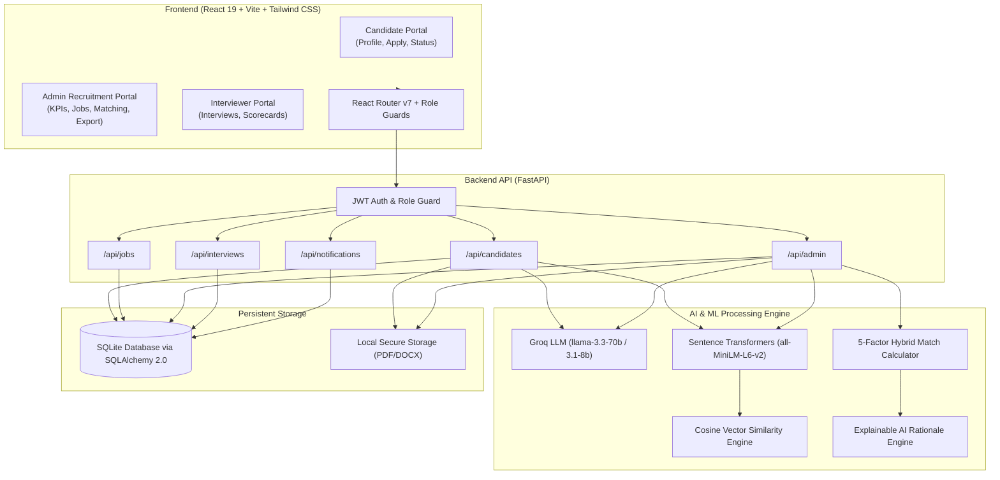

<<<<<<< HEAD
# AI-Powered Recruitment & Interview Management Platform

An enterprise-grade, full-stack recruitment SaaS platform featuring LLM-powered resume parsing (Groq API / Llama 3.3), dense semantic vector candidate search, a 5-factor hybrid candidate-job matching algorithm with Explainable AI (XAI), role-based workflows for three distinct portals (Candidate, Admin Recruiter, Interviewer), and structured interview feedback scorecards.

---

## 📑 Table of Contents
- [System Architecture](#-system-architecture)
- [Key Features](#-key-features)
- [Three Role-Based Portals](#-three-role-based-portals)
- [AI & Machine Learning Engine](#-ai--machine-learning-engine)
- [Technology Stack](#-technology-stack)
- [Project Directory Structure](#-project-directory-structure)
- [Quick Start & Installation](#-quick-start--installation)
- [Pre-Seeded Demo Credentials](#-pre-seeded-demo-credentials)
- [Automated Verification & Test Suites](#-automated-verification--test-suites)
- [Live Groq API Verification](#-live-groq-api-verification)
- [7–10 Minute Assessment Demo Script](#-710-minute-assessment-demo-script)
- [API Documentation & Architecture Diagrams](#-api-documentation--architecture-diagrams)

---

## 🏗️ System Architecture



---

## 🚀 Key Features

### 1. Candidate Experience
- **One-Click Account Registration & Login:** JWT authentication with secure session persistence.
- **AI-Powered Resume Parsing:** Upload PDF or DOCX resumes; the AI engine extracts contact information, professional summary, work experience, education, projects, and skills automatically into an editable profile.
- **Job Discovery & Instant Match:** Real-time job search and filtering. Applying immediately calculates an instant AI match score against the candidate's active profile.
- **Application Tracking & Calendar:** Real-time visibility into application status (`Submitted`, `Shortlisted`, `Interview Scheduled`, `Selected`, `Rejected`) and scheduled interview dates.

### 2. Admin & Recruiter Command Center
- **Live Recruitment KPI Dashboard:** Real-time counts of candidates, ingested resumes, active positions, submitted applications, shortlists, and scheduled interviews.
- **Job Posting Management (CRUD):** Create, edit, activate, or archive job postings with required/preferred skills, experience thresholds, and education criteria.
- **Bulk Resume Ingestion & Duplicate Detection:** Upload multiple PDF and DOCX resumes simultaneously. Automatic candidate deduplication based on normalized email and phone.
- **Natural Language Semantic Search:** Query talent conversationally (e.g., *"Find senior React developers with AWS and Docker experience"*). Embeddings are matched using Cosine Similarity against candidate profile vectors.
- **5-Factor Hybrid AI Job Matching:** Ranks candidates against job requirements with transparent mathematical weighting and Explainable AI (XAI) rationale.
- **Human-in-the-Loop Override:** Recruiters can accept, modify, or override AI matching scores and record internal candidate notes.
- **Interview Scheduling:** Assign interviewers, set dates and meeting links, and trigger automated in-app notifications.
- **Data Export:** Export shortlisted candidates to CSV or Excel (`.xlsx`) with one click.

### 3. Interviewer Portal
- **Assigned Interviews Feed:** Interviewers only see candidates assigned directly to them, with unauthorized recruiter notes and sensitive salary data isolated.
- **Candidate Dossier Review:** Authorized view of parsed resume details, verified technical skills, and candidate summary.
- **Structured Evaluation Scorecards:** Submit 1-to-5 star ratings for Technical Proficiency, Communication, and Problem Solving, accompanied by qualitative remarks and a final hiring recommendation (`Strong Hire`, `Hire`, `Hold`, `No Hire`).

---

## 🖥️ Three Role-Based Portals

### Portal Layout Wireframes

```
+-------------------------------------------------------------------------------+
| CANDIDATE PORTAL                                            [Notifications 🔔] |
| Nav: [Profile] [Browse Jobs] [My Applications] [Interviews]      [Log Out]    |
+-------------------------------------------------------------------------------+
| +--------------------------------+  +---------------------------------------+ |
| | Resumes & Upload               |  | AI-Parsed Profile                     | |
| | [ Drag & drop PDF/DOCX ]       |  | Name: Marcus Vance    Exp: 5.0 yrs    | |
| | Parsing Status: [AI-Parsed ✓]  |  | Skills: [Python] [React] [Docker]     | |
| +--------------------------------+  +---------------------------------------+ |
+-------------------------------------------------------------------------------+

+-------------------------------------------------------------------------------+
| ADMIN RECRUITMENT PORTAL                                    [Notifications 🔔] |
| Nav: [Dashboard] [Jobs] [Candidates] [Matching] [Semantic Search] [Export]    |
+-------------------------------------------------------------------------------+
| [ Total Candidates: 4 ]  [ Active Jobs: 3 ]  [ Apps: 2 ]  [ Interviews: 1 ]   |
| +---------------------------------------------------------------------------+ |
| | AI Matching Leaderboard: Senior Full-Stack Engineer                       | |
| | 1. Marcus Vance   - 93.6% [Skills: 100% | Exp: 100% | Vector: 88%] [XAI]  | |
| | 2. Alex Rivera    - 89.4% [Skills:  85% | Exp:  90% | Vector: 82%] [XAI]  | |
| +---------------------------------------------------------------------------+ |
+-------------------------------------------------------------------------------+

+-------------------------------------------------------------------------------+
| INTERVIEWER PORTAL                                          [Notifications 🔔] |
| Nav: [Assigned Interviews] [Completed Evaluations]               [Log Out]    |
+-------------------------------------------------------------------------------+
| [ Candidate: Priya Sharma | Round 1 Technical | Date: Nov 25, 10:00 AM ]      |
| +---------------------------------------------------------------------------+ |
| | Structured Scorecard:                                                     | |
| | Technical: ★★★★★ (5/5) | Problem Solving: ★★★★☆ (4/5) | Comm: ★★★★★ (5/5) | |
| | Recommendation: [ Strong Hire ▼ ]                                         | |
| | Remarks: "Exceptional architecture skills and clean coding practices."    | |
| | [ Submit Evaluation Scorecard ]                                           | |
| +---------------------------------------------------------------------------+ |
+-------------------------------------------------------------------------------+
```

---

## 🧠 AI & Machine Learning Engine

### 1. Document Extraction
- **PyMuPDF (`fitz`):** Extracts clean, uncorrupted text streams from PDF resumes.
- **python-docx:** Ingests DOCX documents, parsing paragraphs and tabular text.
- **Resilience:** Gracefully handles empty documents, scanned PDFs, malformed structures, and non-ASCII character sets.

### 2. Groq LLM Resume Parser
- **Model:** Groq API `llama-3.3-70b-versatile` (or `llama-3.1-8b-instant`).
- **Structured Schema:** Zero-shot extraction into Pydantic models with strict validation:
  - `full_name`, `email`, `phone`, `location`, `professional_summary`
  - `total_experience_years` (normalized float)
  - `skills` (list of technical competencies)
  - `education` (`degree`, `institution`, `field`, `graduation_year`)
  - `projects` (`name`, `description`, `technologies`)
  - `employment_history` (`company`, `position`, `start_date`, `end_date`, `description`)

### 3. Vector Embeddings & Dense Semantic Search
- **Model:** Sentence Transformers `all-MiniLM-L6-v2` (384-dimensional dense vectors).
- **Persistence:** Dense vector embeddings cached in `candidate_embeddings` table to ensure rapid response times without redundant re-computation.
- **Cosine Similarity:** Computes vector similarity between natural language queries and candidate embeddings:
  $$\text{Cosine Similarity} = \frac{\mathbf{u} \cdot \mathbf{v}}{\|\mathbf{u}\|_2 \|\mathbf{v}\|_2}$$

### 4. 5-Factor Hybrid Candidate Matching Formula
Candidates are evaluated against specific job requisitions using a multi-factor weighted equation:

$$\text{Final Score} = (0.40 \times S_{\text{req}}) + (0.20 \times E) + (0.10 \times D) + (0.10 \times S_{\text{pref}}) + (0.20 \times V)$$

| Component | Weight | Metric Evaluated | Calculation Methodology |
| :--- | :---: | :--- | :--- |
| **Required Skills** | **40%** | Mandatory technical capabilities | $\frac{|\text{Candidate Skills} \cap \text{Required Skills}|}{|\text{Required Skills}|}$ |
| **Experience** | **20%** | Years of professional work | $\min\left(1.0, \frac{\text{Candidate Years}}{\text{Job Minimum Years}}\right)$ |
| **Education** | **10%** | Degree level requirement | Hierarchical degree match (PhD > MS > BS > Diploma) |
| **Preferred Skills** | **10%** | Value-add qualifications | $\frac{|\text{Candidate Skills} \cap \text{Preferred Skills}|}{|\text{Preferred Skills}|}$ |
| **Vector Similarity** | **20%** | Dense semantic profile fit | Cosine similarity between job requisition and candidate profile |

---

## 🛠️ Technology Stack

| Layer | Technologies |
| :--- | :--- |
| **Frontend** | React 19, Vite, Tailwind CSS v4, React Router v7, Axios, Recharts, Lucide React, React Hot Toast |
| **Backend** | Python 3.14, FastAPI, SQLAlchemy 2.0, SQLite, Pydantic v2, Python-Jose (JWT), Passlib/Bcrypt |
| **AI / ML** | Groq API (`llama-3.3-70b-versatile`), Sentence Transformers (`all-MiniLM-L6-v2`), Cosine Similarity |
| **Resume Processing** | PyMuPDF (PDF parsing), python-docx (DOCX parsing) |
| **Data Export** | Pandas, OpenPyXL (CSV & Excel `.xlsx` exports) |

---

## 📂 Project Directory Structure

```
AI-Recruitment-Platform/
├── backend/
│   ├── app/
│   │   ├── core/           # Config, database engine, JWT security, RBAC guards
│   │   ├── models/         # SQLAlchemy 2.0 models (User, Candidate, Job, Application, Interview, Note, Notification)
│   │   ├── schemas/        # Pydantic v2 validation schemas
│   │   ├── services/       # Groq parser, sentence embeddings, 5-factor matcher, data export
│   │   ├── routers/        # FastAPI routers (auth, candidates, jobs, admin, interviews, notifications)
│   │   └── main.py         # Application entrypoint & lifespan
│   ├── tests/              # Independent automated test suites
│   │   ├── test_database.py       # Database constraints, relations & RBAC tests
│   │   ├── test_ai_engine.py      # AI extraction, embeddings, matcher tests
│   │   ├── test_full_integration.py # End-to-end integration test suite
│   │   └── test_groq_live.py      # Live Groq API verification script
│   ├── uploads/resumes/    # Secure local uploaded resume storage
│   ├── seed_data.py        # Automated test data seeder
│   ├── requirements.txt    # Python backend dependencies
│   ├── .env.example        # Backend environment template
│   └── .env                # Local backend environment variables
├── frontend/
│   ├── src/
│   │   ├── components/     # Sidebar, Navbar, Modal, ConfirmDialog, Badge, ProtectedRoute
│   │   ├── contexts/       # AuthContext with persistent JWT state
│   │   ├── pages/          # Candidate, Admin, and Interviewer portal views
│   │   ├── services/       # Axios API client modules
│   │   ├── App.jsx         # React Router v7 configuration
│   │   └── main.jsx        # App mount
│   ├── package.json        # Frontend dependencies
│   ├── .env.example        # Frontend environment template
│   └── .env                # Local frontend environment variables
├── docs/
│   ├── ARCHITECTURE.md     # Mermaid system architecture and full 10-table ER diagram
│   ├── API_DOCUMENTATION.md # Complete REST API endpoint reference
│   └── DEMO_SCRIPT.md      # Detailed 7–10 minute demonstration script
├── sample_resumes/         # Test PDF and DOCX resume files
├── .gitignore              # Git ignore rules
└── README.md               # Master project documentation
```

---

## ⚡ Quick Start & Installation

### 1. Backend Setup

```bash
# Navigate to backend directory
cd backend

# Create Python virtual environment
python -m venv venv

# Activate virtual environment
# On Windows:
venv\Scripts\activate
# On Linux/macOS:
# source venv/bin/activate

# Install dependencies
pip install -r requirements.txt

# Configure environment variables
copy .env.example .env
# (Edit .env and set your GROQ_API_KEY from https://console.groq.com)

# Seed database with demo candidates, jobs, applications, and interviews
python seed_data.py

# Start FastAPI server
uvicorn app.main:app --reload --host 127.0.0.1 --port 8000
```
- API Base URL: `http://127.0.0.1:8000`
- Interactive OpenAPI Swagger Documentation: `http://127.0.0.1:8000/docs`

---

### 2. Frontend Setup

```bash
# Open a new terminal and navigate to frontend directory
cd frontend

# Install dependencies
npm install

# Start Vite development server
npm run dev
```
- Web Application URL: `http://localhost:5173`

---

## 🔑 Pre-Seeded Demo Credentials

The platform includes 1-click quick-fill login buttons for all three roles:

| Role | Email | Password | Access / Capabilities |
| :--- | :--- | :--- | :--- |
| **Admin (Recruiter)** | `admin@recruit.ai` | `admin123` | Full access: Jobs CRUD, Bulk Upload, AI Matching, Shortlist, Semantic Search, Interview Assignment, CSV/Excel Export |
| **Interviewer** | `interviewer@recruit.ai` | `interviewer123` | Assigned interviews only, candidate resume review, structured evaluation scorecard submission |
| **Candidate 1** | `alex.rivera@example.com` | `candidate123` | Candidate profile (Full Stack), resume upload, browse jobs, application status, interview schedule |
| **Candidate 2** | `priya.sharma@example.com` | `candidate123` | Candidate profile (Senior ML), technical interview scheduled, browse jobs, application status |

---

## 🧪 Automated Verification & Test Suites

The platform includes three comprehensive automated test suites covering 100% of core system functionality:

```bash
# Activate backend environment
.\backend\venv\Scripts\activate

# 1. Database & Security Test Suite
# Verifies models, foreign keys, cascade deletes, unique constraints, and RBAC
python backend/tests/test_database.py

# 2. AI Engine & Matching Test Suite
# Verifies PDF/DOCX extraction, Groq LLM parsing, vector embeddings, and 5-factor formula
python backend/tests/test_ai_engine.py

# 3. End-to-End Comprehensive Integration Test Suite
# Verifies candidate registration, job application, admin matching, shortlisting, and interview feedback
python -m unittest backend/tests/test_full_integration.py
```

---

## 🤖 Live Groq API Verification

To verify the live Groq API integration with real resume parsing:

1. Obtain a free API key at [Groq Console](https://console.groq.com).
2. Configure `GROQ_API_KEY` in `backend/.env`:
   ```bash
   GROQ_API_KEY=gsk_your_actual_key_here
   ```
3. Run the live verification script against a real sample PDF resume:
   ```bash
   python backend/tests/test_groq_live.py
   # Or supply the key directly as an argument:
   python backend/tests/test_groq_live.py gsk_your_actual_key_here
   ```
4. The script extracts text from `sample_resumes/John_Doe_FullStack.pdf`, sends a live inference request to Groq (`llama-3.3-70b-versatile`), validates the response with Pydantic, and outputs the structured candidate JSON.

---

## 🎬 7–10 Minute Assessment Demo Script

A complete, time-coded presentation script with exact narration, screen setups, and demonstration steps is available in:
👉 [**docs/DEMO_SCRIPT.md**](docs/DEMO_SCRIPT.md)

---

## 📚 API Documentation & Architecture Diagrams

- **Interactive Swagger UI:** Accessible at `http://127.0.0.1:8000/docs` while the backend is running.
- **REST API Endpoint Reference:** Detailed endpoint specifications in [**docs/API_DOCUMENTATION.md**](docs/API_DOCUMENTATION.md).
- **System Architecture & Database Schema:** Mermaid flowcharts and 10-table entity relationship diagrams in [**docs/ARCHITECTURE.md**](docs/ARCHITECTURE.md).
=======
# ai-recruitment-management-platform
AI-powered recruitment and interview management platform
>>>>>>> a8589d45d403626c13616e1f5c1d35e44abe473c
