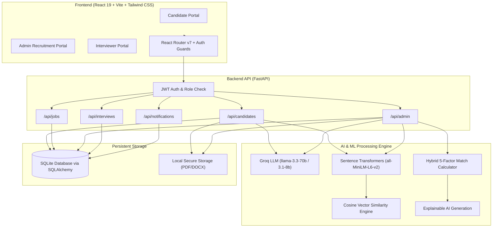
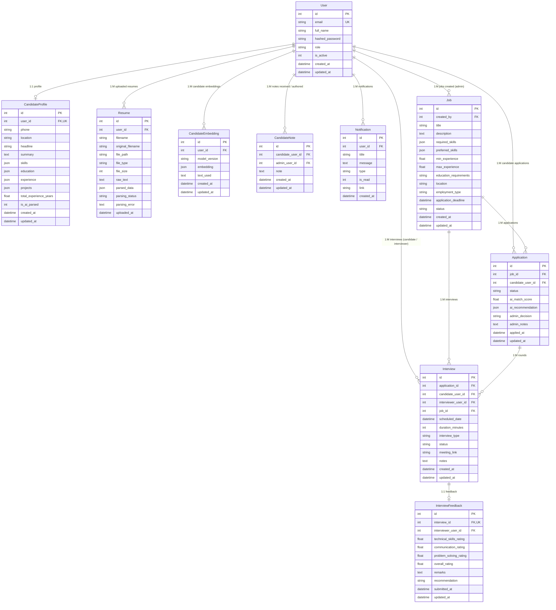

# AI-Powered Recruitment & Interview Management Platform: Architecture & Database Schema

## 1. System Overview

The platform is designed as an enterprise-grade full-stack recruitment and interview intelligence system. It automates candidate resume parsing, semantic talent search, hybrid multi-factor candidate ranking, interview scheduling, and feedback management.

---

## 2. Database Schema & Relational Model

The database is built on SQLAlchemy 2.0 with automated table generation and runtime SQLite foreign key enforcement via `@event.listens_for(engine, "connect")` executing `PRAGMA foreign_keys=ON;`.

---

## 3. Database Constraints & Relationships Map

| # | Relationship Description | Parent Model | Child Model | Relationship Attributes |
|---|---|---|---|---|
| 1 | One user has one candidate profile | `User` | `CandidateProfile` | `profile = relationship("CandidateProfile", back_populates="user", uselist=False, cascade="all, delete-orphan")` |
| 2 | One candidate has multiple resumes | `User` | `Resume` | `resumes = relationship("Resume", back_populates="user", cascade="all, delete-orphan")` |
| 3 | One candidate has multiple applications | `User` | `Application` | `applications = relationship("Application", back_populates="candidate", cascade="all, delete-orphan")` |
| 4 | One job has multiple applications | `Job` | `Application` | `applications = relationship("Application", back_populates="job", cascade="all, delete-orphan")` |
| 5 | One candidate has one embedding per model version | `User` | `CandidateEmbedding` | `embeddings = relationship("CandidateEmbedding", back_populates="user", cascade="all, delete-orphan")`; `UniqueConstraint("user_id", "model_version")` |
| 6 | One candidate has multiple internal notes | `User` | `CandidateNote` | `candidate_notes = relationship("CandidateNote", foreign_keys="CandidateNote.candidate_user_id", back_populates="candidate", cascade="all, delete-orphan")` |
| 7 | One candidate has multiple interviews | `User` | `Interview` | `candidate_interviews = relationship("Interview", foreign_keys="Interview.candidate_user_id", back_populates="candidate", cascade="all, delete-orphan")` |
| 8 | One interviewer assigned multiple interviews | `User` | `Interview` | `assigned_interviews = relationship("Interview", foreign_keys="Interview.interviewer_user_id", back_populates="interviewer")` |
| 9 | One interview has interview feedback | `Interview` | `InterviewFeedback` | `feedback = relationship("InterviewFeedback", back_populates="interview", uselist=False, cascade="all, delete-orphan")`; `unique=True` on `interview_id` |
| 10 | One user receives multiple notifications | `User` | `Notification` | `notifications = relationship("Notification", back_populates="user", cascade="all, delete-orphan")` |

### Key Integrity Constraints:
- **Duplicate Application Prevention:** `UniqueConstraint("job_id", "candidate_user_id", name="uq_job_candidate")` on table `applications`.
- **Duplicate Model Embedding Prevention:** `UniqueConstraint("user_id", "model_version", name="uq_candidate_embedding_model")` on table `candidate_embeddings`.
- **One Feedback per Interview:** `unique=True` on `interview_feedback.interview_id`.
- **Foreign Key Enforcing Engine:** SQLite pragma `PRAGMA foreign_keys=ON;` enforced on every DBAPI connection.
